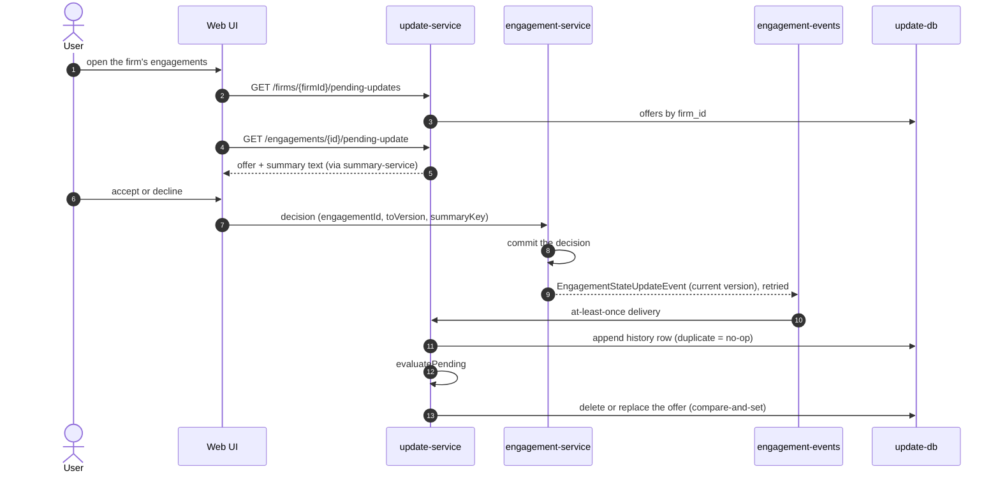
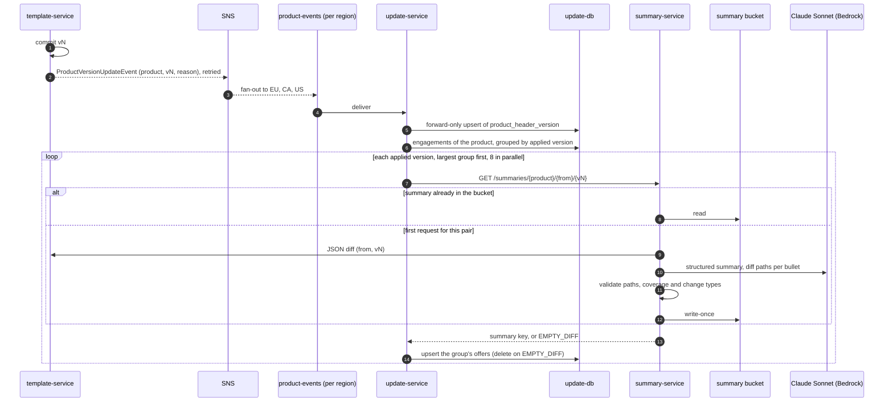
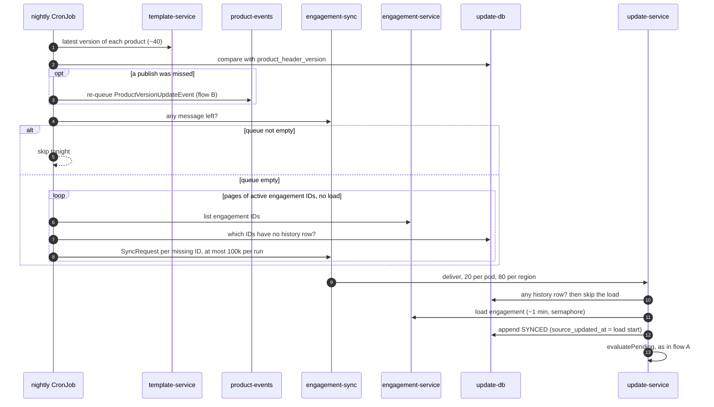

# Pending Template Updates: Design

## 1. Scope / Context

**Problem.** An engagement file is created from a product template (zipped JSON) and stays on that version. Users accept or decline each update per engagement, so they need to see at a glance which engagements have one pending, with a human-readable summary.

**Scale.** 4,000 firms · 800,000 active engagements · 40 products · median firm ~40 engagements, largest ~40,000 · ~1 publish per product per week ≈ 173/month.

**Hard constraints**
- Reading an engagement's template version means loading it: **~1 min each**, on a system another team owns with limited capacity.
- The template DB is shared and has no engagement data; engagements live in customer DBs, some required to stay in the **EU or Canada**.
- All systems are live: no maintenance window, and **existing** engagements must be covered.
- Versions branch, get withdrawn, and pile up before a decision. A firm that declined v5 may later be offered v7, which contains v5.
- All-in cost must stay under $X/month, including inference. A summary shown in March must hold up in a review in November.

**Assumptions**
- A1. `product_id` = template + market branch, so each product has one increasing sequence of versions.
- A2. A withdrawal is published as a new version (v8 restores v6's content).
- A3. engagement-service can list engagement IDs without loading them. Each of its events carries the engagement's current template version, not just the change, and never its content.
- A4. The engagement team grants **80 concurrent loads per region**.
- A5. Regions are EU, CA and US.
- A6. Templates are not firm-specific, so one summary serves every firm and region.

**Left out:** applying updates, notifications, admin endpoints, cross-branch moves, per-firm summaries, summary-service failover (an outage only delays offers).

## 2. Goals / Non-Goals

- Every active engagement, new or existing, shows a pending update when it has one, listed per firm.
- At most one offer per engagement, from its applied version to the latest, with a validated summary.
- Correct when messages are duplicated, reordered or lost. A gap is detected, never silent.
- Client data stays in its region; every decision traces to the exact summary shown; the load budget is never exceeded.
- **Non-goals:** offers within seconds of a publish (§5); owning decisions (engagement-service stays the system of record).

**Delivery approach**
- **Hidden until complete:** the UI stays off until the backfill covers every existing engagement, so there's no partial or "checking" state.
- **Gold set from the backfill:** summaries for publishes during the ~8-night backfill are generated unseen; the content team reviews them into a **gold set** that every prompt or model change must pass.
- **Pilot before everyone:** one firm (ideally one per region) uses it for 2–3 publishes; its auditors, who would defend a decision in a review, validate the wording.

## 3. Design

### Architecture

- Existing services (`*`) publish their event right after each commit, with retries; lost events are covered under Correctness.
- **update-service** (one per region) owns version history and offers. **summary-service** (global, no database) owns summaries. The only thing that leaves a region is `(product, from, to)`.

### Data ownership & model

| Data | Owner | Where |
|---|---|---|
| Template versions, JSON diffs | template-service | Global |
| Engagements, decisions (system of record) | engagement-service | Region |
| Summaries | summary-service | Global S3, written once |
| History and offers (derived, can be rebuilt) | update-service | `update-db`, per region |

| `update-db` table | Key | Content |
|---|---|---|
| `product_header_version` | `product_id` | Latest version. Updated only forward. |
| `engagement_history` | `engagement_id, source_updated_at, event_type` | Rows are only ever added: CREATED / ACCEPTED / DECLINED / SYNCED / ARCHIVED, each with `applied_version`, `declined_version`, `summary_key`, `actor_id`. The latest row is the current state. |
| `pending_update` | `engagement_id` | The current offer: `from`, `to`, `summary_key`. Deleted once it no longer applies (decided, archived or `EMPTY_DIFF`). |

**Version rules**
- An update is pending when the engagement isn't archived, `latest > applied`, and `latest > max(declined)`.
- **Pile-up:** v5 to v7 landing before a decision give one offer `v4 → v7`, replaced in place; replacing is not declining.
- **Declined:** the engagement keeps its applied version, and offers stop until a version newer than the declined one arrives. v7 then comes as `v4 → v7`, which includes v5's changes.
- **Withdrawal (A2):** for an engagement on v6, `v6 → v8` is `EMPTY_DIFF`, so the offer is removed and no decision is recorded. For one on v7, `v7 → v8` reads "withdraws v7".

**Correctness**
- **Duplicates:** the history primary key, the forward-only version upsert, and offer writes that are safe to repeat.
- **Order:** the latest `source_updated_at` wins. Sync rows carry the time their load *started*, so a decision made during the 1-minute load wins.
- **Races:** an offer is written only if the history row and product version it was computed from are still current (compare-and-set). Otherwise the newer change re-evaluates it.
- **Loss:** events are sent after commit with retries (no outbox). The nightly job re-queues engagements without history and any missed publish; a lost decision is re-emitted when the user acts on the stale offer (idempotent decision endpoint); dead-letter queues (DLQs) have alarms.

### Summary generation & evaluation
- **One summary per `(product, from, to, promptVersion)`**, shared by every firm and region. Cost follows the number of version pairs (~20 per publish), not engagements. Each summary is written once, so every region shows the same text.
- **Pipeline:** get the JSON diff. If it's empty, return `EMPTY_DIFF` without calling the LLM. Otherwise, Claude Sonnet on Bedrock (pinned model, versioned prompt, template data only) returns `{text, changeType, diffPaths[]}` for each bullet.
- **Validator (code):** every cited path exists, every changed path is cited, and each change type matches the diff. After two failures, the summary falls back to a labelled plain rendering of the diff, so an offer is never blocked.
- **Audit:** S3 Object Lock keeps the text, bullets, diff hash, model, prompt version and validator result for the audit period. Summaries are never regenerated; a new prompt or model writes new keys. Each decision row keeps `summary_key` and `actor_id`.
- **Evaluation:** offline, the gold set (§2) must pass before any prompt or model change ships. Online, we track the pass rate, the fallback rate and a reviewed weekly sample.

### Key tradeoffs
- **A derived store**, not an extension of engagement-service. We own the build and can see across firms; the cost is a sync and a risk of drift.
- **A code validator**, not an LLM judge. It's free, deterministic and auditable; the gold set covers tone.
- **SQS idempotency** (a visibility timeout, plus skipping the load if history exists), not a claim table. **Two queues**, so decisions never wait behind 1-minute loads.

## 4. Flows

**A. Review, decide, and other engagement events**

- CREATED and ARCHIVED events join at step 9. Accepting an older offer while a newer version exists yields a new offer from the accepted version.

**B. Template publish (including withdrawal)**

- A late or duplicate event (v7 arriving after v8) changes nothing.

**C. Nightly sync (backfill and completeness check)**

- The first runs are the backfill; later runs check completeness (`sync.missing` should be 0).
- 100k ≈ one day of loads, so each run starts on an empty queue; an engagement stuck in the DLQ is still missing, so the next run re-queues it.

## 5. Risks

**Challenged requirement: "within seconds of a template being published."** Instead, an offer appears with its validated summary, within 5 minutes at p95. Updates are weekly and decisions take days; an unexplained offer can't be decided or defended, and seconds would mean showing unvalidated text.

**Riskiest component: completeness of `engagement_history`.** A missing or outdated row hides a pending update without any visible error. Mitigations: the Correctness rules (§3), version-carrying events, the `sync.missing` alert, and pilot spot-checks.

| Failure | Mitigation |
|---|---|
| Sync loads slow down engagement-service | A hard cap (§7) and at most 100k per night. To pause, scale the sync listener to 0. |
| The LLM or summary-service is down, or output fails validation | SQS retries, then the plain rendering of the diff. Offers arrive late at worst, never wrong, and nothing is lost. |
| A message for the wrong region, or one that keeps failing | Sent to the DLQ after 5 attempts, with an alarm. Engagements still missing are queued again by the next sync. |

## 6. Metrics

| Quantity | Arithmetic | Result |
|---|---|---|
| Backfill | 800k × 1 min ÷ 80 | ≈ 7 days (~8 nightly runs) |
| Backfill compute | 800k × ~$0.001 per load (1 vCPU·min + 4 GB·min) | ≈ $0.8k one-time |
| Publish fan-out | ~20 version groups (max 52), 8 summaries in parallel × ~30 s | 1.5–3.5 min |
| Summaries | 173 publishes × 20–52 pairs | 3.5k–9k / month |
| LLM (Sonnet) | 20k input + 1.5k output tokens at $2 / $10 per million ≈ $0.055 | $0.2–0.5k / month (≈ $190k if summarised per engagement) |
| Storage | 800k × ~10 rows/yr × 150 B; 9k × 100 KB/month | ≈ 1.2 GB/yr in RDS; ≈ 1 GB/month in S3 |
| Messaging | Events and sync requests | < 1 msg/s, < $10 / month |

**Run cost ≈ $5k/month:** 3 × RDS SQL Server Multi-AZ ≈ $4.3k (mostly licences), LLM $0.2–0.5k, EKS ≈ $0.3k, SQS/SNS/S3 < $0.1k. If $X is tight, cut the database tier (Web or Express edition, or a shared instance) before the model. 

| SLO / alert | Target |
|---|---|
| Publish → offer visible | p95 ≤ 5 min |
| Decision → offer updated | p99 ≤ 1 min (age of the oldest queued message) |
| Pending-list API | p99 ≤ 300 ms |
| Completeness | Alert if `sync.missing` > 0 after the backfill |
| engagement-service | In-flight loads ≤ the cap; alert if more than 5% of loads fail |
| Summaries | Validator pass rate ≥ 95%, fallback ≤ 5%, weekly sample ≥ 95% approved |

Alerts also fire on any DLQ message and on the daily LLM budget. Logs and metrics carry only opaque IDs, the region and the outcome.

## 7. Config

| Parameter | Value |
|---|---|
| Region | EU / CA / US; messages for other regions go to the DLQ |
| Sync permits per pod × pods | 20 × 4 = 80 (A4) |
| Load timeout / visibility timeout / `maxReceiveCount` | 120 s / 300 s / 5, then the DLQ |
| Sync cap / schedule | 100k per run / 02:00 local time, runs never overlap |
| Summary parallelism / validator retries | 8 per publish / 2 |
| Model ID / prompt version | Pinned / versioned; changing either writes new keys |
| Flags | `pending-updates.ui` per firm; emitters per region |

## 8. Rollout

1. **Deploy, hidden.** All stacks go live with the UI flag off, versions seeded, and emitters turned on region by region.
2. **Turn on the nightly sync.** Its first runs are the backfill, and offers appear as engagements sync. Done when `sync.missing` = 0 and the gold set is reviewed.
3. **Pilot firm.** UI on for 2–3 publishes. Done when the pilot signs off on the wording.
4. **Everyone.** UI on for all firms.

- Every change is additive, so there is no downtime; rollback is the UI flag, and update-db can be rebuilt by the sync. Events are versioned and only gain fields; a new region is one more regional stack.

## 9. Rejected

- **Re-check every engagement on every publish.** 3.46M loads/month needs ≥ 80 loads in parallel forever and ~4 h per publish, breaking capacity and freshness; stacked per-version summaries misstate the net change.
- **engagement-service stores the version in each customer DB.** Strongest consistency, but the capacity-limited team builds it, ~4,000 live DBs need schema changes, and there's no cross-firm view.
